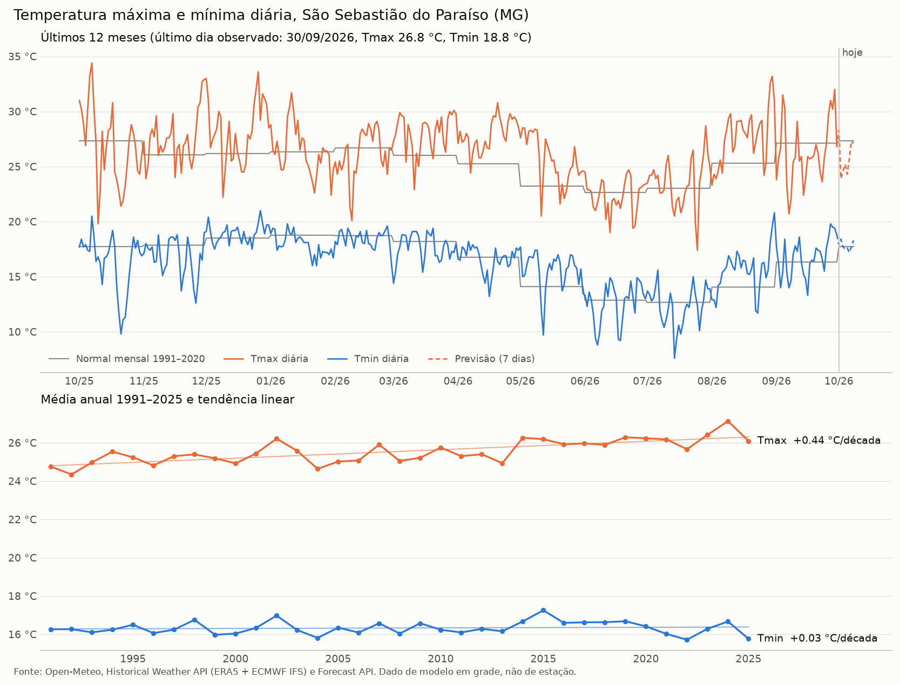

# Temperatura no Sul e Sudoeste de Minas

Plano inicial de Iniciação Científica: fontes de dados de temperatura com atualização frequente para a
mesorregião **Sul/Sudoeste de Minas** (IBGE 3110, 146 municípios), série temporal de **Tmax e Tmin** de
**São Sebastião do Paraíso (SSP)**, relatório em **Quarto** e dashboard em **Shiny for Python**, publicados
no **Posit Connect Cloud**.

| Entrega | Onde |
|---|---|
| Pesquisa das APIs (testadas em 01/10/2026) | [`docs/pesquisa-apis.md`](docs/pesquisa-apis.md) |
| Download e gráfico da série de SSP | [`scripts/baixar_serie.py`](scripts/baixar_serie.py) → [`figuras/`](figuras/) |
| Relatório Quarto | [`relatorio.qmd`](relatorio.qmd) · **[abrir o relatório publicado](https://01a0f8d2-171b-4f7b-84e7-4f8cd9831e22.share.connect.posit.cloud/)** |
| Dashboard (aplicativo) | [`app.py`](app.py) · **[abrir o dashboard publicado](https://01a0f901-27b9-6e6e-be10-1d5711961833.share.connect.posit.cloud/)** |
| Guia dos dados (didático) | [`docs/guia-dos-dados.md`](docs/guia-dos-dados.md) |
| Guia do código (didático) | [`docs/guia-do-codigo.md`](docs/guia-do-codigo.md) |



## Principais achados

- **Open-Meteo** é a melhor fonte para uma série contínua e atualizada todo dia: vai de 1940 até ontem,
  não exige chave e devolve os 146 municípios numa só chamada. É dado de modelo (ERA5 + ECMWF IFS).
- **INMET**: o catálogo de estações é aberto, mas os dados em tempo real exigem **token**
  (pedido a `cadastro.act@inmet.gov.br`). Os arquivos anuais do **BDMEP** são abertos e chegam até o mês anterior.
- A estação do INMET em **SSP (A561) está em pane**, com 0% de dados de temperatura em 2026. A operante mais
  próxima é **Passos (A516)**, a ~40 km.
- Validação Open-Meteo × INMET (jan.–ago. 2026, 7 estações): correlação de 0,81 a 0,96, mas a Open-Meteo
  **subestima a Tmax (−1 a −2 °C)** e **superestima a Tmin (+1 a +3 °C)**. É preciso corrigir o viés antes de
  estudar extremos.
- Tendência 1991–2025 em SSP (Open-Meteo): Tmax **+0,44 °C/década**, Tmin +0,03 °C/década.

## Estrutura

```text
clima_ssm/            pacote Python com o código reutilizável
  fontes.py           Open-Meteo, NASA POWER, normais e anomalias
  inmet.py            catálogo, API com token e arquivos do BDMEP
  regiao.py           municípios, malha do IBGE e estações da mesorregião
  validacao.py        comparação Open-Meteo × INMET
  graficos.py         figura estática da série (matplotlib)
scripts/
  preparar_regiao.py  gera dados/municipios_ssm.*, dados/estacoes_inmet_ssm.csv
  baixar_serie.py     baixa a série de um município e gera o gráfico
  processar_bdmep.py  baixa o BDMEP do INMET e salva Tmax/Tmin diários das estações
dados/                tabelas geradas pelos scripts
figuras/              gráficos gerados
relatorio.qmd         relatório em Quarto Markdown
app.py                dashboard Shiny for Python
```

## Como rodar no computador

Requer Python 3.11. No terminal do Positron ou do VS Code, dentro da pasta do projeto:

```bash
python -m venv .venv
.venv\Scripts\activate          # Windows (no Linux/macOS: source .venv/bin/activate)
pip install -r requirements.txt

python scripts/baixar_serie.py                         # SSP
python scripts/baixar_serie.py --municipio "Varginha"  # qualquer município da mesorregião
python scripts/processar_bdmep.py 2026                 # atualiza os dados das estações do INMET

quarto render relatorio.qmd     # gera relatorio.html
shiny run app.py                # abre o dashboard em http://127.0.0.1:8000
```

No **Positron**: abra a pasta (*File → Open Folder*), escolha o interpretador do `.venv`, abra `app.py` e clique
em **▶ Run Shiny App**, ou abra `relatorio.qmd` e clique em **Preview**.

> Observação: neste computador (Intel i5-3570, sem AVX2) a versão padrão do Polars não roda, por isso o projeto usa pandas.

## Publicação no Posit Connect Cloud

Os dois conteúdos estão publicados (públicos) a partir da branch `main` deste repositório:
[relatório](https://01a0f8d2-171b-4f7b-84e7-4f8cd9831e22.share.connect.posit.cloud/) e
[dashboard](https://01a0f901-27b9-6e6e-be10-1d5711961833.share.connect.posit.cloud/). Depois de um `git push`,
use **Republicar** na página do conteúdo em <https://connect.posit.cloud> para o servidor pegar a versão nova.

**Pelo GitHub (nova publicação):** em <https://connect.posit.cloud>, entre com a conta do GitHub, clique em **Publish**,
escolha o repositório, a branch `main` e o arquivo principal: `relatorio.qmd` para o relatório (tipo Quarto) ou `app.py`
para o dashboard (tipo Shiny). Use Python 3.11. O Connect Cloud instala o `requirements.txt` e roda o código no servidor.

**Pelo Positron:** abra o arquivo, clique no ícone **Posit Publisher** na barra lateral, adicione a credencial do
Connect Cloud (*Credentials → + → Posit Connect Cloud*) e clique em **Deploy Your Project**.

## Próximos passos

1. Pedir o token da API do INMET para ter observação horária quase em tempo real.
2. Baixar o BDMEP de 2016–2019, quando a estação de SSP funcionava, e validar a Open-Meteo no próprio município.
3. Testar correção de viés (mensal ou por quantis) com base nas estações.
4. Índices de extremos (geada para o café: Tmin < 3 °C; calor: Tmax > 32 °C).
5. Atualização diária automática (GitHub Actions) e republicação do relatório.

## Créditos

Autoria: Mauris81 (Iniciação Científica). Colaboração: Claude (Anthropic), na pesquisa das APIs, no código e na documentação.
