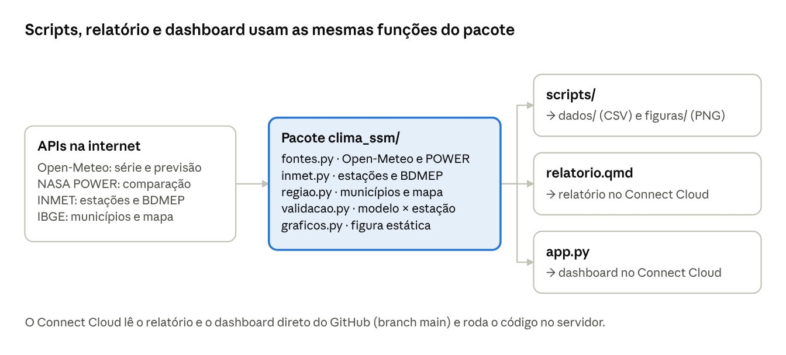

# Guia do código – aprendendo com o projeto

Atualizado em 01/10/2026

## Mapa do projeto

O projeto tem um **pacote** (`clima_ssm/`) com todas as funções que buscam e tratam dados, e três **usuários** desse pacote: os scripts, o relatório e o dashboard. Quem entende o pacote entende o resto.



A vantagem dessa divisão: uma correção feita em `fontes.py` vale ao mesmo tempo para o script, o relatório e o dashboard. Se o código de download estivesse copiado em três lugares, seria fácil corrigir um e esquecer os outros. Este guia segue a ordem do desenho: primeiro o ambiente, depois o pacote, por fim quem o usa.

## Preparando o ambiente

O projeto roda num **ambiente virtual** (a pasta `.venv`): uma cópia isolada do Python com os pacotes do projeto. Assim o Python do seu computador fica intacto e o projeto sempre usa as mesmas versões.

**Abrindo no VS Code.** A pasta já está aberta em *Documents\ic-temperatura-sul-minas*. Na primeira vez, aceite instalar as extensões recomendadas (Python, Quarto, Shiny e Rainbow CSV). O arquivo `.vscode/settings.json` já aponta para o Python do `.venv`.

**O terminal.** No VS Code, abra com *Terminal → New Terminal* (ou Ctrl+'). Se o início da linha mostrar `(.venv)`, o ambiente está ativo. Se não mostrar, rode:

```text
.venv\Scripts\activate
```

**Instalando os pacotes do zero** (em outro computador, por exemplo):

```text
python -m venv .venv
.venv\Scripts\activate
pip install -r requirements.txt
```

O arquivo `requirements.txt` lista cada pacote com a versão exata testada (pandas 3.0.6, shiny 1.8.0 etc.). O Connect Cloud lê esse mesmo arquivo para montar o servidor.

**E o Positron?** É o editor da Posit, parecido com o VS Code, mas feito para ciência de dados: já vem com Quarto, mostra as variáveis da sessão e tem botão para rodar o Shiny e publicar no Connect Cloud. Use o que preferir; o código é o mesmo.

**Uma curiosidade deste computador.** O processador (Intel i5-3570, de 2012) não tem a instrução AVX2, e a biblioteca Polars travava com "Illegal instruction". Por isso o projeto usa pandas, que funciona em qualquer máquina.

## O Python que aparece no projeto

Cinco ideias cobrem quase todo o código: importar, criar funções, montar textos com f-strings, usar listas e dicionários, e trabalhar com tabelas no pandas. Os exemplos abaixo foram tirados do próprio projeto.

**1. Importar** traz código de outro lugar. `import pandas as pd` traz o pandas com o apelido `pd`; `from clima_ssm import fontes` traz um arquivo do nosso pacote.

**2. Funções** guardam uma tarefa com nome, para usar várias vezes. O que vem entre parênteses são os parâmetros; `return` devolve o resultado. O texto entre aspas triplas é a explicação da função (*docstring*).

```python
def br(v: float, casas: int = 1) -> str:
    """Número no formato brasileiro (vírgula decimal)."""
    return f"{v:.{casas}f}".replace(".", ",")

br(26.84)      # → "26,8"
br(26.84, 2)   # → "26,84"
```

As anotações `: float` e `-> str` são só lembretes do tipo esperado; o Python não obriga. `casas: int = 1` é um valor padrão: se você não informar, usa 1.

**3. f-strings** montam textos com valores dentro: `f"Tmax {valor:.1f} °C"` vira "Tmax 26.8 °C". O `:.1f` quer dizer "uma casa decimal".

**4. Listas e dicionários.** Lista é uma sequência: `["tmax", "tmin"]`. Dicionário associa chave a valor: `{"latitude": -20.9167, "longitude": -46.9837}`. As APIs devolvem JSON, que o Python lê justamente como dicionários e listas.

**5. pandas** é a biblioteca de tabelas. Uma tabela é um `DataFrame`; cada coluna é uma `Series`. As operações mais usadas aqui:

| O que fazer | Código | Exemplo no projeto |
| --- | --- | --- |
| Ler um CSV | `pd.read_csv("arquivo.csv")` | `regiao.municipios()` |
| Filtrar linhas | `df[df["tmax"] > 30]` | dias acima de 30 °C |
| Criar coluna | `df["amplitude"] = df["tmax"] - df["tmin"]` | anomalias em `com_normal()` |
| Agrupar e resumir | `df.groupby(df["data"].dt.month)["tmax"].mean()` | normal mensal |
| Juntar tabelas | `a.merge(b, on="data")` | modelo × estação na validação |
| Média móvel | `df["tmax"].rolling(7, center=True).mean()` | chave "Suavizar" do dashboard |
| Salvar CSV | `df.to_csv("saida.csv", index=False)` | scripts |

O `.dt` dá acesso às partes de uma data: `.dt.year`, `.dt.month`, `.dt.strftime("%d/%m/%Y")`. Valores faltando aparecem como `NaN` e são ignorados nas médias.

## fontes.py: de uma chamada de API até uma tabela

Toda função de `clima_ssm/fontes.py` segue o mesmo caminho em três passos: **pedir** os dados à API, **ler** o JSON e **devolver** uma tabela com as colunas `data`, `tmax`, `tmin` e `fonte`. Entendendo uma, você entende todas.

**Passo 1: pedir (`_get`).** A biblioteca `requests` faz o papel do navegador. Os parâmetros vão num dicionário, e ela monta a URL com `?latitude=...&longitude=...`. Se a resposta não for 200 (o código de "deu certo"), a função para com uma mensagem clara.

```python
def _get(url, params):
    r = requests.get(url, params=params, headers=CABECALHO, timeout=TIMEOUT)
    if r.status_code != 200:
        raise RuntimeError(f"{url} respondeu {r.status_code}")
    return r.json()          # texto JSON → dicionário do Python
```

O nome começa com `_` por convenção: é uma função "interna", usada pelas outras funções do arquivo. O `timeout=90` evita que o programa fique esperando para sempre se a API travar.

**Passo 2: ler a resposta.** A Open-Meteo devolve algo assim (encurtado):

```python
{"latitude": -20.91, "elevation": 963.0,
 "daily": {"time": ["1991-01-01", "1991-01-02", ...],
           "temperature_2m_max": [27.1, 28.4, ...],
           "temperature_2m_min": [18.0, 17.6, ...]}}
```

São três listas do mesmo tamanho: a posição 0 de cada uma é o primeiro dia, a posição 1 é o segundo, e assim por diante.

**Passo 3: virar tabela (`_diario`).** As três listas viram colunas de um DataFrame. `pd.to_datetime` transforma o texto "1991-01-01" em data de verdade (para poder pegar o mês, o ano etc.). Linhas sem Tmax e sem Tmin são descartadas.

```python
def open_meteo_historico(lat, lon, inicio="1991-01-01", fim=None):
    js = _get(URL_OM_HISTORICO, {
        "latitude": lat, "longitude": lon,
        "start_date": str(inicio), "end_date": str(fim or ontem()),
        "daily": "temperature_2m_max,temperature_2m_min",
        "timezone": FUSO})
    d = js["daily"]
    return _diario(d["time"], d["temperature_2m_max"], d["temperature_2m_min"], "Open-Meteo (histórico)")
```

Repare em `fim or ontem()`: se ninguém passar uma data final, usa ontem. Assim a série se atualiza sozinha todo dia.

**Experimente no terminal** (com o `.venv` ativo, digite `python` e depois):

```python
from clima_ssm import fontes
df = fontes.open_meteo_historico(-21.5556, -45.4364, "2026-01-01")   # Varginha
df.head()                      # primeiras 5 linhas
df["tmax"].max()               # maior Tmax do ano
```

As outras funções do arquivo seguem o mesmo molde: `open_meteo_previsao` (rota de previsão), `open_meteo_varios_pontos` (vários municípios numa chamada, para o mapa) e `nasa_power` (troca −999 por vazio). No fim do arquivo estão as contas: `climatologia_mensal`, `normal_diaria` e `com_normal` (anomalias).

## inmet.py: estações, token e arquivos do BDMEP

O `clima_ssm/inmet.py` tem três funções principais, uma para cada porta do INMET: `estacoes()` (catálogo), `dados_api()` (tempo real, com token) e `bdmep_ano()` (arquivo anual). A parte mais instrutiva é a última.

**Se apresentar como navegador.** O servidor do INMET recusa programas desconhecidos. Por isso toda chamada leva o cabeçalho `CABECALHO = {"User-Agent": "Mozilla/5.0 ..."}`, o mesmo tipo de identificação que um navegador envia.

**Token fora do código.** `dados_api()` lê o token da variável de ambiente `INMET_TOKEN`, nunca do código. Assim a senha não vai parar no GitHub público. Quando o token chegar, no terminal:

```text
$env:INMET_TOKEN = "o-token-que-o-inmet-mandar"
```

**Baixando um ZIP grande sem encher a memória.** O arquivo de 2026 tem 64 MB. `bdmep_ano()` baixa em pedaços de 1 MB (`stream=True` + `iter_content`) para um arquivo temporário, que o Python apaga sozinho no fim. Depois abre o ZIP e lê só os CSV das estações da região (o nome do arquivo contém o código, como `_A516_`).

**Lendo o CSV do INMET.** O arquivo tem 8 linhas de informações antes da tabela, usa `;` como separador, vírgula decimal e acentos no padrão antigo (latin-1). Por isso a leitura usa `skiprows=8`, `sep=";"` e `decode("latin-1")`. A função `_num()` troca a vírgula por ponto e transforma `-9999` em vazio.

**De horário para diário (`horario_para_diario`).** É o coração do arquivo:

```python
h = horario.assign(data=(horario["datahora_utc"] + pd.Timedelta(hours=-3)).dt.normalize())
dia = h.groupby(["codigo", "data"]).agg(
    tmax=("tmax_h", "max"),          # maior máxima horária do dia
    tmin=("tmin_h", "min"),          # menor mínima horária do dia
    horas_tmax=("tmax_h", "count"),  # quantas horas tinham dado
    horas_tmin=("tmin_h", "count"),
).reset_index()
dia["tmax"] = dia["tmax"].where(dia["horas_tmax"] >= 18)   # menos de 18 h → vazio
```

Linha a linha: soma −3 horas para sair do UTC; `.dt.normalize()` zera a hora e deixa só a data; `groupby` junta as horas de cada estação em cada dia; `agg` calcula máximo, mínimo e contagem; `.where(...)` mantém o valor só onde a condição é verdadeira.

**Um bug que apareceu e foi corrigido.** Ao voltar 3 horas, as primeiras horas de 1º de janeiro caíram em 31/12 do ano anterior, criando um dia "fantasma" quase vazio. A última linha de `bdmep_ano()` filtra só os dias do ano pedido. Esse tipo de detalhe só aparece quando você olha o resultado com atenção.

## regiao.py, validacao.py e graficos.py

Os outros três arquivos do pacote cuidam da geografia, da comparação com as estações e do gráfico estático. Cada um tem uma ideia que vale aprender.

**regiao.py: "este ponto está dentro deste polígono?"** Para saber em que município cada estação fica, `municipio_do_ponto()` usa o algoritmo do *raio* (ray casting): imagine uma linha saindo do ponto para a direita. Se ela cruza a borda do polígono um número ímpar de vezes, o ponto está dentro; se par, está fora. São 10 linhas de código em `_ponto_no_anel()`, sem biblioteca de mapas.

O mesmo arquivo tem `rotulo_estacao()`: o INMET grava os nomes em maiúsculas e sem acento ("MARIA DA FE"). A função compara com o nome do município do IBGE e, se for o mesmo lugar, usa a grafia certa ("Maria da Fé").

**validacao.py: juntar e comparar.** `pareado()` coloca, lado a lado, a estação e a Open-Meteo no mesmo dia, com um `merge` pela coluna `data`. `metricas()` calcula viés, EAM, REQM e correlação em poucas linhas:

```python
d = p["tmax_mod"] - p["tmax_obs"]       # diferença de cada dia
vies = d.mean()
mae = d.abs().mean()
rmse = np.sqrt((d ** 2).mean())
r = p["tmax_obs"].corr(p["tmax_mod"])
```

Compare com as fórmulas do Guia dos dados: o código é a fórmula escrita em Python.

**graficos.py: o gráfico do matplotlib.** `figura_serie()` monta a figura de dois painéis (últimos 12 meses e médias anuais). Os pontos que valem estudar:

- `plt.subplots(2, 1)` cria uma figura com dois eixos, um embaixo do outro.
- `ax.plot(x, y, color=..., lw=...)` desenha uma linha; `ls=(0, (3, 2))` deixa tracejada (usado na previsão).
- `np.polyfit(anos, valores, 1)` ajusta a reta da tendência: devolve a inclinação e o ponto de partida. A inclinação vezes 10 dá graus por década.
- As cores ficam em constantes no topo (`COR_TMAX` laranja, `COR_TMIN` azul), para todos os gráficos do projeto usarem a mesma combinação.

## Os scripts da pasta scripts/

Scripts são os arquivos que você **roda** no terminal; o pacote `clima_ssm` só guarda as funções. Cada script chama algumas funções do pacote e salva o resultado em `dados/` ou `figuras/`.

| Script | O que faz | Quando rodar |
| --- | --- | --- |
| `preparar_regiao.py` | Baixa municípios, contornos e estações | Uma vez (ou se o IBGE/INMET mudar) |
| `baixar_serie.py` | Baixa a série de um município e gera o gráfico | Sempre que quiser a série atualizada |
| `processar_bdmep.py` | Baixa o ZIP anual do INMET e salva Tmax/Tmin diários | Uma vez por mês, quando o INMET atualizar |

Três peças aparecem em todos eles:

**1. Achar o pacote.** Como os scripts ficam numa subpasta, a linha abaixo diz ao Python para procurar módulos também na pasta de cima, onde está `clima_ssm`:

```python
sys.path.insert(0, str(Path(__file__).resolve().parent.parent))
```

**2. Receber opções do terminal (`argparse`).** É o que permite escrever `--municipio "Varginha"`:

```python
p = argparse.ArgumentParser()
p.add_argument("--municipio", default="São Sebastião do Paraíso")
nome = p.parse_args().municipio
```

**3. `if __name__ == "__main__":`** O código dentro desse `if` só roda quando o arquivo é executado diretamente (`python scripts/baixar_serie.py`), e não quando outro arquivo o importa. É uma convenção de quase todo script Python.

**Roteiro de `baixar_serie.py`**, em ordem: procura o município na tabela → baixa o histórico desde 1991 → baixa a previsão e guarda só os dias que o histórico ainda não tem → junta tudo com `pd.concat` → salva o CSV → desenha a figura com `graficos.figura_serie()` → salva o PNG.

## O relatório Quarto (relatorio.qmd)

Um arquivo `.qmd` mistura **texto** (em Markdown) e **código** (em Python). Ao renderizar, o Quarto roda cada bloco de código e coloca o resultado (tabela, gráfico, número) no lugar do bloco, gerando um HTML. Por isso o relatório sempre mostra os dados do dia em que foi renderizado.

**1. O cabeçalho (YAML)**, entre as linhas `---`, configura o documento:

```yaml
title: "Temperatura máxima e mínima no Sul e Sudoeste de Minas"
date: today            # data do dia da renderização
lang: pt               # textos automáticos em português ("Figura", "Tabela")
format:
  html:
    toc: true          # sumário na lateral
    code-fold: true    # código escondido atrás de "Mostrar código"
    embed-resources: true   # tudo num arquivo só
```

**2. Os blocos de código** começam com três crases e `{python}`. As linhas `#|` no topo são opções do bloco:

```python
#| label: fig-serie
#| fig-cap: "Tmax e Tmin diárias dos últimos 12 meses..."
fig = graficos.figura_serie(serie, ssp["nome"])
plt.show()
```

`label: fig-...` numera como "Figura N" e `fig-cap` é a legenda. Com `tbl-` no lugar de `fig-`, vira "Tabela N".

**3. Código dentro do texto.** Na frase "146 municípios", o número não foi digitado: o texto tem `` `{python} len(mun)` ``, e o Quarto troca pelo resultado. Se a região mudar, o texto muda junto.

**4. Plano B sem internet.** O bloco que baixa a série usa `try` / `except`: tenta a API e, se falhar, lê o CSV salvo em `dados/`. O relatório avisa qual das duas origens usou.

**Como renderizar.** No Positron ou no VS Code (com a extensão Quarto), abra o arquivo e clique em **Preview**. Pelo terminal:

```text
quarto render relatorio.qmd
```

Neste computador o Quarto veio dentro do Positron e não está no PATH do terminal. Pelo terminal, use o caminho completo `C:\Users\mauri\AppData\Local\Programs\Positron\resources\app\quarto\bin\quarto.exe` ou instale o Quarto separadamente.

O Connect Cloud faz exatamente isso no servidor a cada publicação, usando o `requirements.txt` (que inclui o `jupyter`, necessário para o Quarto rodar Python).

## O dashboard Shiny (app.py)

Um app Shiny tem duas metades: a **interface** (`app_ui`), que diz o que aparece na tela, e o **servidor** (`server`), que calcula o que vai em cada espaço. A mágica é a **reatividade**: quando você muda um controle, o Shiny recalcula só o que depende dele.

**A interface** é montada com funções `ui.*`, uma dentro da outra, como caixas:

- `ui.page_sidebar(...)`: página com barra lateral.
- Controles (*inputs*): `ui.input_selectize("municipio", ...)`, `ui.input_date_range("periodo", ...)`, `ui.input_switch("previsao", ...)`. O primeiro texto é o **id**, o nome pelo qual o servidor lê o valor.
- Espaços de saída (*outputs*): `output_widget("g_serie")` para gráfico, `ui.output_text(...)` para texto, `ui.output_data_frame(...)` para tabela.
- Organização: `ui.value_box` (as caixas de destaque), `ui.navset_card_underline` com um `ui.nav_panel` por aba.

**O servidor** é uma função com três tipos de peças:

1. **`@render...`** preenche um output. O nome da função é o id do espaço: `def g_serie()` preenche `output_widget("g_serie")`.
2. **`@reactive.calc`** é um cálculo intermediário compartilhado. `historico()` baixa a série uma vez; o gráfico, as caixas e a tabela usam o mesmo resultado.
3. **`@reactive.effect`** executa uma ação. Quando você clica em "1 ano", ele muda as datas do seletor de período.

O Shiny descobre sozinho quem depende de quem: toda vez que uma função lê `input.periodo()` ou chama `historico()`, ele anota a ligação.

```python
@reactive.calc
def historico():                  # depende do município escolhido
    return _historico(codigo(), fontes.hoje())

@reactive.calc
def periodo():                    # depende do histórico e das datas
    inicio, fim = input.periodo()
    h = historico()
    return h[(h["data"].dt.date >= inicio) & (h["data"].dt.date <= fim)]

@render.text
def vb_ontem_valor():             # caixa "Último dia observado"
    u = historico().iloc[-1]      # última linha da tabela
    return f"{br(u['tmax'])}° / {br(u['tmin'])}°"
```

Se você trocar só as datas, `historico()` não é refeito (não depende delas); só `periodo()` e o que vem depois.

**Cache das APIs.** As funções `_historico`, `_previsao` e `_regional` usam `@lru_cache`, que guarda o resultado na memória. A chave inclui a data de hoje (ou a hora), então o app não chama a API de novo a cada clique, mas busca dados novos quando o dia vira.

**Os gráficos (Plotly)** são montados com `go.Figure()` e `fig.add_scatter(x=..., y=..., name=..., line=dict(color=...))`. O `@render_plotly` (do pacote shinywidgets) mostra a figura e deixa passar o mouse para ver os valores.

**Limitação conhecida.** Selecionar o município clicando no mapa não funcionou: o clique não chega ao Python por uma incompatibilidade entre shinywidgets 0.8 e Plotly 7. Por isso a escolha é feita na barra lateral.

**Para rodar:** `shiny run app.py` no terminal e abrir http://127.0.0.1:8000, ou o botão ▶ *Run Shiny App* no Positron/VS Code. Depois de editar o código, pare (Ctrl+C) e rode de novo, ou use `shiny run --reload app.py`, que reinicia sozinho a cada alteração.

## Git, GitHub e publicação

O ciclo do dia a dia tem quatro passos: **editar** no VS Code → **commit** (salvar uma versão no Git) → **push** (mandar para o GitHub) → **republicar** no Connect Cloud.

**Git** é o histórico de versões do projeto, guardado na pasta oculta `.git`. **GitHub** é o site que guarda uma cópia desse histórico: [mauris81/ic-temperatura-sul-minas](https://github.com/mauris81/ic-temperatura-sul-minas). Cada *commit* é uma foto do projeto com uma mensagem explicando o que mudou.

Pelo terminal:

```text
git status                         # o que mudou desde o último commit
git add .                          # marca todas as mudanças para o próximo commit
git commit -m "Adiciona Varginha"  # salva a versão com uma mensagem
git push                           # envia para o GitHub
```

No VS Code dá para fazer o mesmo pela aba **Source Control** (o ícone de ramificação na barra da esquerda): escreva a mensagem, clique em *Commit* e depois em *Sync Changes*.

**Autoria.** Os commits têm você como autor (Mauris81 <maurisribas@gmail.com>), porque usam a configuração do Git deste computador. O Claude aparece só na última linha da mensagem, "Colaboração: Claude (Anthropic)", que o GitHub não trata como coautoria.

**O que não vai para o GitHub.** O arquivo `.gitignore` lista o que o Git ignora: a pasta `.venv` (pesada e recriável com `pip install`), o `relatorio.html` (o Connect Cloud gera o seu) e configurações locais como `.vscode/`. Senhas e tokens nunca devem ser commitados; por isso o token do INMET fica numa variável de ambiente.

**Connect Cloud.** Os dois conteúdos estão publicados a partir da branch `main` do GitHub:

| Conteúdo | Arquivo principal | Endereço |
| --- | --- | --- |
| Relatório | `relatorio.qmd` | [link do relatório](https://01a0f8d2-171b-4f7b-84e7-4f8cd9831e22.share.connect.posit.cloud/) |
| Dashboard | `app.py` | [link do dashboard](https://01a0f901-27b9-6e6e-be10-1d5711961833.share.connect.posit.cloud/) |

Depois de um `git push`, abra o conteúdo em connect.posit.cloud e use a aba **Republicar**: o servidor baixa a versão nova, reinstala o `requirements.txt` e roda tudo de novo. O dashboard busca dados ao vivo, então não precisa ser republicado para ficar atualizado; o relatório, sim (é renderizado só na publicação).

## Exercícios para praticar

Os exercícios vão do mais fácil ao mais difícil; cada um mexe numa parte diferente do projeto. Faça um commit a cada exercício terminado, para treinar o Git também.

- [ ] **Rodar para outra cidade.** Gere a série e o gráfico de Poços de Caldas com `python scripts/baixar_serie.py --municipio "Poços de Caldas"` e abra o PNG em `figuras/`.
- [ ] **Explorar no terminal.** Leia `dados/serie_sao_sebastiao_do_paraiso.csv` com `pd.read_csv(..., parse_dates=["data"])` e descubra o dia mais quente e o mais frio desde 1991.
- [ ] **Contar dias de geada.** Conte quantos dias por ano SSP teve Tmin abaixo de 3 °C. Dica: `df[df["tmin"] < 3].groupby(df["data"].dt.year).size()`.
- [ ] **Nova coluna.** Crie a amplitude térmica (`tmax - tmin`) e calcule a média por mês. Em que mês ela é maior?
- [ ] **Mudar o relatório.** Acrescente ao `relatorio.qmd` uma seção com o exercício da geada (texto + bloco de código) e renderize.
- [ ] **Mudar o dashboard.** Inclua o atalho "2 anos" no seletor de período. Dica: o dicionário `ATALHOS` no `app.py`.
- [ ] **Validar com mais anos.** Rode `python scripts/processar_bdmep.py 2025 2026` e veja se o viés de Passos muda.
- [ ] **Desafio.** Escreva uma função `corrigir_vies(df, normal_obs, normal_mod)` que some a cada dia a diferença entre as normais mensais da estação e do modelo. Compare o EAM antes e depois.

Quando travar, leia a mensagem de erro de baixo para cima: a última linha diz o que deu errado e as anteriores mostram onde.
