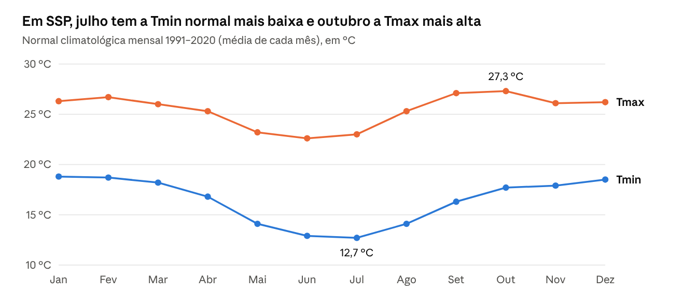
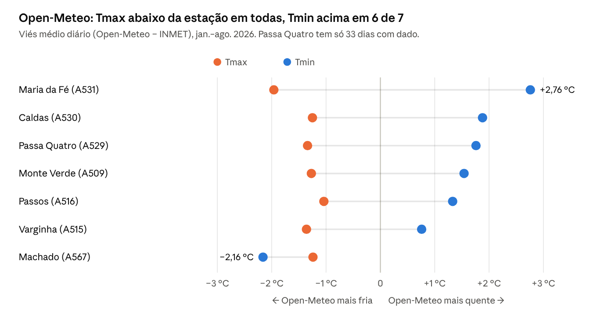

# Guia dos dados – Temperatura no Sul e Sudoeste de Minas

Atualizado em 01/10/2026

## Visão geral

O projeto usa uma fonte principal (Open-Meteo), uma de comparação (NASA POWER), uma de referência observada (INMET) e uma de geografia (IBGE). Todas foram acessadas pela internet, sem pagar nada, e testadas em 01/10/2026.

A ideia central é simples: a Open-Meteo dá uma série **contínua e atualizada todo dia**, mas é calculada por modelo; as estações do INMET são **medição real**, mas têm falhas. Por isso usamos a primeira para a série e a segunda para conferir a primeira.

| Fonte | O que é | Como foi obtida | Atualização | Papel no projeto |
| --- | --- | --- | --- | --- |
| Open-Meteo (histórico) | Temperatura diária calculada por modelo (reanálise) | API aberta, sem cadastro | Todo dia, até ontem | Série principal 1991 → hoje |
| Open-Meteo (previsão) | Previsão de hoje + 7 dias | API aberta, sem cadastro | Várias vezes ao dia | Previsão e mapa da região |
| NASA POWER | Temperatura diária de outro modelo, grade mais grossa | API aberta, sem cadastro | Todo dia, 2–3 dias de atraso | Comparação no dashboard |
| INMET (catálogo) | Lista de estações, coordenadas e situação | API aberta (com cabeçalho de navegador) | Contínua | Saber quais estações existem |
| INMET (BDMEP) | Medições horárias das estações automáticas | Arquivo ZIP anual no portal | Cerca de 1 vez por mês | Validar a Open-Meteo |
| IBGE | Lista dos municípios e seus contornos | API de localidades e malhas | Estável | Definir a região e desenhar o mapa |

## A região de estudo

A região é a mesorregião **Sul/Sudoeste de Minas** do IBGE (código 3110): 146 municípios em 10 microrregiões. A cidade-foco é **São Sebastião do Paraíso (SSP)**, código IBGE 3164704.

As 10 microrregiões são Alfenas, Andrelândia, Itajubá, Passos, Pouso Alegre, Poços de Caldas, Santa Rita do Sapucaí, São Lourenço, São Sebastião do Paraíso e Varginha.

Três dados geográficos foram baixados uma única vez pelo script `scripts/preparar_regiao.py`:

1. **Lista dos municípios**: API de localidades do IBGE, que devolve nome, código e microrregião de cada município da mesorregião.
2. **Coordenadas das sedes**: o IBGE não entrega latitude e longitude nessa API. Por isso usei a base aberta *municipios-brasileiros* (GitHub), que traz o ponto da sede de cada município. SSP fica em −20,9167 de latitude e −46,9837 de longitude.
3. **Contornos (polígonos)**: API de malhas do IBGE, em formato GeoJSON (69 kB na qualidade mínima). Servem para desenhar o mapa e para descobrir em qual município cada estação está.

**Detalhe técnico que apareceu no caminho:** o IBGE desenha os polígonos no sentido anti-horário (padrão oficial do GeoJSON), mas a biblioteca de mapas (Plotly) espera o sentido horário. Sem corrigir, o mapa pintava o mundo inteiro menos o município. A função `malha_para_plotly()` inverte a ordem dos pontos antes de desenhar.

## Open-Meteo: a série principal

A Open-Meteo entregou a série de SSP de **01/01/1991 a 30/09/2026 (13.057 dias) sem nenhum dia faltando**, mais a previsão de hoje + 7 dias. Não pede cadastro nem chave e é gratuita para uso não comercial.

**O que é esse dado.** Não é um termômetro. É uma **reanálise**: um modelo de computador junta milhões de observações (estações, satélites, balões) e calcula a temperatura em cada ponto de uma **grade** regular, como um tabuleiro sobre o mapa. A Open-Meteo usa a reanálise ERA5 (europeia) e, para os dias mais recentes, a análise do modelo ECMWF IFS. O valor de cada dia representa um quadrado de 9 a 25 km, não o ponto exato da cidade.

**Como foi baixado.** Uma chamada à *Historical Weather API* pedindo Tmax e Tmin diárias no ponto da sede, no fuso de São Paulo:

```text
https://archive-api.open-meteo.com/v1/archive?latitude=-20.9167&longitude=-46.9837
  &start_date=1991-01-01&end_date=2026-09-30
  &daily=temperature_2m_max,temperature_2m_min&timezone=America/Sao_Paulo
```

A resposta vem em JSON (texto organizado em chaves e listas): uma lista de datas e duas listas de temperaturas, na mesma ordem. O código transforma isso numa tabela com as colunas `data`, `tmax` e `tmin`. A previsão vem de outra rota (*Forecast API*), com os parâmetros `past_days` e `forecast_days`.

**Um detalhe que importa.** A Open-Meteo devolve o ponto de grade mais próximo: para SSP foi (−20,914; −46,960), com altitude de modelo de 963 m. A estação do INMET em SSP fica a 845 m. Essa diferença de altitude já explica parte das diferenças de temperatura.

**Por que ela foi escolhida.** É a única fonte testada que junta três coisas: série longa, sem falhas e atualizada até ontem. Além disso, aceita vários pontos numa só chamada: os 146 municípios vieram em 1,9 segundo, o que torna possível o mapa do dashboard.

## NASA POWER: a segunda opinião

A NASA POWER funcionou, mas o último dia disponível no teste era **28/09/2026**, cerca de 3 dias de atraso. Por isso ela entra só como comparação no dashboard (chave "Comparar com NASA POWER").

- **O que é:** outro produto de modelo (MERRA-2 e GEOS, da NASA), com grade de cerca de 0,5°, ou seja, quadrados de uns 50 km. É bem mais grossa que a Open-Meteo.
- **Como foi baixada:** API aberta, pedindo os parâmetros `T2M_MAX` e `T2M_MIN` (temperatura a 2 m do chão) entre duas datas.
- **Cuidado com o valor −999:** quando falta dado, a POWER escreve −999 em vez de deixar vazio. O código troca esse número por "sem dado" antes de qualquer conta. Sem isso, uma média sairia absurda.

No dashboard, para Varginha, a Tmax da POWER aparece quase sempre acima da Open-Meteo. Comparar dois modelos mostra que **fontes diferentes dão números diferentes**, e por isso a validação com estações é indispensável.

## INMET: a referência medida

O INMET é a fonte oficial de medição, mas em 2026 a estação de **SSP (A561) está em pane e não registrou nenhuma temperatura**. A estação funcionando mais perto é **Passos (A516)**, a cerca de 40 km.

O INMET oferece três portas de acesso, e cada uma se comportou de um jeito:

1. **Catálogo de estações** (`apitempo.inmet.gov.br/estacoes/T`): aberto. Lista 672 estações automáticas no Brasil, com código, coordenadas e situação. Detalhe: o servidor recusa a conexão se o programa não se apresentar como navegador (cabeçalho `User-Agent`).
2. **API de dados em tempo real**: **exige token** (uma senha de acesso). Sem ele, as rotas públicas devolvem resposta vazia (código 204) e a rota com chave responde "CHAVE INVÁLIDA!". O token é pedido por e-mail a `cadastro.act@inmet.gov.br`. O código para usá-lo já está pronto.
3. **BDMEP (dados históricos)**: arquivo ZIP por ano no portal, aberto. O de 2026 tem 64 MB, 639 arquivos (um por estação) e vai até 31/08/2026.

**Como o dado horário virou diário.** Cada CSV do BDMEP tem uma linha por hora, em horário UTC (o horário de Londres, 3 horas à frente de Brasília). Usei duas colunas: "temperatura máxima na hora anterior" e "temperatura mínima na hora anterior". O processo foi:

1. Converter cada hora de UTC para o horário local (menos 3 horas). Sem isso, as 21h, 22h e 23h de um dia cairiam no dia seguinte.
2. Agrupar as 24 horas de cada dia local.
3. Tmax do dia = a maior das máximas horárias; Tmin do dia = a menor das mínimas horárias.
4. **Regra de qualidade:** se o dia tiver menos de 18 horas com dado (75%), ele fica vazio. Um dia com 5 horas medidas daria uma Tmax falsa.

**As estações da região.** Para saber quais estações ficam dentro da mesorregião, o código testou se o ponto de cada estação cai dentro de algum dos 146 polígonos do IBGE. Resultado: 8 automáticas e 1 convencional (Passa Quatro, 83737). A cobertura de 2026 varia muito:

| Código | Estação | Município | Situação no catálogo | Dias com Tmax (jan.–ago. 2026) |
| --- | --- | --- | --- | --- |
| A509 | Monte Verde | Camanducaia | Operante | 100% |
| A531 | Maria da Fé | Maria da Fé | Operante | 100% |
| A530 | Caldas | Caldas | Operante | 98% |
| A516 | Passos | Passos | Operante | 81% |
| A515 | Varginha | Varginha | Operante | 75% |
| A567 | Machado | Machado | Operante | 68% |
| A529 | Passa Quatro | Passa Quatro | Operante | 14% |
| A561 | São Sebastião do Paraíso | São Sebastião do Paraíso | Pane | 0% |

Repare que "Operante" no catálogo não garante dado: Passa Quatro está operante e tem só 14% dos dias. Essas falhas são o motivo de não usar a estação como série principal.

## Fontes testadas e descartadas

Três fontes foram testadas e ficaram de fora porque **não têm dado recente da região** ou estavam fora do ar.

| Fonte | O que é | Resultado do teste (01/10/2026) |
| --- | --- | --- |
| Meteostat | Base que reorganiza observações de estações do mundo todo | As estações da região param entre 2019 e 2022; a de SSP (83631), em 2019 |
| NOAA GSOD | Resumos diários do serviço meteorológico dos EUA | Consultas de 2026 para Varginha, Passos, SSP e Caldas vieram vazias |
| CPTEC/INPE (via BrasilAPI) | Previsão do tempo por cidade | Erro 500 (falha no servidor) ao buscar a cidade; além disso, só tem previsão |

Há também APIs comerciais (OpenWeatherMap, Visual Crossing, WeatherAPI) e o Copernicus/ERA5 direto da fonte. Todas exigem cadastro ou chave e **não foram testadas**; podem entrar depois, se a pesquisa pedir.

## Como os dados foram tratados

Quatro cálculos transformam a série bruta em informação: normal climatológica, anomalia, média móvel e tendência. Em SSP, a tendência de 1991 a 2025 foi de **+0,44 °C por década na Tmax** e +0,03 °C por década na Tmin.

**Normal climatológica** é o "clima esperado": a média de 30 anos (1991–2020, o período padrão da Organização Meteorológica Mundial). O relatório calcula uma normal por mês. O dashboard calcula uma por dia do ano e a suaviza com média de 31 dias, para a linha cinza não ficar dentada.



*Open-Meteo, ponto da sede de SSP · médias mensais de 1991 a 2020 (mesma tabela do relatório).*

**Anomalia** é o quanto um dia ou mês fugiu do normal: anomalia = valor observado − normal. Se a Tmin normal de julho é 12,7 °C e um dia de julho teve 9,7 °C, a anomalia foi −3,0 °C. Na caixa "Últimos 30 dias × normal" do dashboard aparece a média das anomalias dos últimos 30 dias.

**Média móvel de 7 dias** troca cada valor pela média dele com os 3 dias antes e os 3 depois. Ela apaga o sobe e desce do dia a dia e deixa ver a tendência de semanas. É a chave "Suavizar" do dashboard.

**Tendência linear** é a reta que melhor passa pelas médias anuais (método dos mínimos quadrados). A inclinação da reta, multiplicada por 10, dá "graus por década". O ano corrente fica de fora porque ainda está incompleto e puxaria a média. Esses números vêm de reanálise e de um só ponto: são um indício, não uma conclusão científica.

## Validação: a Open-Meteo bate com as estações?

Em parte. A Open-Meteo acompanha bem o sobe e desce diário (correlação de 0,81 a 0,96), mas **erra o nível**: a Tmax sai mais baixa que a medida em todas as 7 estações, e a Tmin sai mais alta em 6 delas.

**Como foi feito.** Para cada estação com dado em 2026, o código baixou a Open-Meteo no ponto exato da estação, para os mesmos dias. Depois juntou as duas séries lado a lado, dia por dia, e calculou quatro medidas. Nas fórmulas, M é o valor do modelo (Open-Meteo), O é o observado (INMET) e n é o número de dias.

**Viés**: a diferença média. Negativo = o modelo fica abaixo da estação; positivo = acima. Erros para cima e para baixo se cancelam.

```latex
\text{Viés} = \frac{1}{n}\sum_{i=1}^{n} (M_i - O_i)
```

**EAM (erro absoluto médio)**: o tamanho médio do erro, sem sinal. Responde "em média, quantos graus o modelo erra?". Ficou entre 1,1 e 2,8 °C.

```latex
\text{EAM} = \frac{1}{n}\sum_{i=1}^{n} \lvert M_i - O_i \rvert
```

**REQM (raiz do erro quadrático médio)**: parecida com o EAM, mas pesa mais os erros grandes. Ficou entre 1,4 e 3,4 °C.

```latex
\text{REQM} = \sqrt{\frac{1}{n}\sum_{i=1}^{n} (M_i - O_i)^2}
```

**r (correlação de Pearson)**: mede se as duas séries sobem e descem juntas, de −1 a 1. Perto de 1 = acompanham bem, mesmo que uma esteja deslocada da outra.



*INMET BDMEP 2026 × Open-Meteo no ponto de cada estação · 7 estações, jan.–ago. 2026 (valores da Tabela 2 do relatório).*

**Como ler o resultado.** O modelo "achata" a amplitude térmica: dias quentes saem menos quentes e noites frias saem menos frias. Isso é típico de reanálise, porque o quadrado de grade mistura vales, morros e cidades numa média. Machado é a exceção (Tmin −2,16 °C) e merece investigação.

**O que isso significa para a IC.** A Open-Meteo serve para ver padrões e variações. Para estudar extremos, como geada (Tmin muito baixa) ou ondas de calor, ela precisa de **correção de viés** com base nas estações. Em Passos, a estação mais próxima de SSP, o viés foi −1,04 °C na Tmax e +1,33 °C na Tmin, em 196 dias. Os números completos estão na Tabela 2 do relatório e na aba "Estações INMET" do dashboard.

## Os arquivos da pasta dados/

Todos os dados salvos no repositório são gerados por scripts, então **nada foi digitado à mão**: para atualizar, basta rodar o script de novo. Os CSV abrem no Excel, no VS Code (extensão Rainbow CSV) ou no pandas.

| Arquivo | O que tem | Colunas | Gerado por |
| --- | --- | --- | --- |
| `municipios_ssm.csv` | Os 146 municípios | `codigo_ibge`, `nome`, `microrregiao`, `lat`, `lon` | `scripts/preparar_regiao.py` |
| `municipios_ssm.geojson` | Contorno de cada município | polígonos com `codarea` (código IBGE) | `scripts/preparar_regiao.py` |
| `estacoes_inmet_ssm.csv` | As 9 estações do INMET na região | `codigo`, `nome`, `lat`, `lon`, `altitude`, `situacao`, `tipo` (T = automática, M = convencional), `municipio` | `scripts/preparar_regiao.py` |
| `serie_sao_sebastiao_do_paraiso.csv` | Tmax e Tmin diárias de SSP, 1991 → hoje + previsão | `data`, `tmax`, `tmin`, `fonte`, `previsao` (True nos dias de previsão) | `scripts/baixar_serie.py` |
| `inmet_bdmep_diario.csv` | Tmax e Tmin diárias medidas nas estações, 2026 | `codigo`, `data`, `tmax`, `tmin`, `horas_tmax`, `horas_tmin` (horas com dado no dia) | `scripts/processar_bdmep.py` |

Temperaturas sempre em °C e datas no formato ano-mês-dia (2026-09-30). Célula vazia = dia sem dado confiável.

Para atualizar, no terminal do VS Code com o `.venv` ativo:

```text
python scripts/baixar_serie.py                          # SSP até ontem
python scripts/baixar_serie.py --municipio "Varginha"   # outro município
python scripts/processar_bdmep.py 2026                  # estações do INMET
```

## Limitações e próximos passos

O principal limite hoje é que **SSP não tem medição própria em 2026**: a série da cidade é só de modelo, validada em estações vizinhas.

- **Um ponto não é o município inteiro.** Usamos a coordenada da sede; um município grande tem áreas mais altas e mais baixas.
- **Validação curta.** São 8 meses de 2026. O ideal é usar vários anos, inclusive 2016–2019, quando a estação de SSP funcionava.
- **Tendência com cautela.** A tendência de +0,44 °C por década vem de reanálise e de um só ponto; para afirmar algo cientificamente é preciso teste estatístico e comparação com estações.
- **Dependência da internet.** O dashboard busca os dados na hora; se a Open-Meteo sair do ar, ele para de atualizar.

Próximos passos sugeridos:

- [ ] Pedir o token da API do INMET (`cadastro.act@inmet.gov.br`)
- [ ] Baixar o BDMEP de 2016–2019 e validar a Open-Meteo no próprio município de SSP
- [ ] Testar uma correção de viés simples (mês a mês) e ver se o erro cai
- [ ] Calcular índices de extremos, como dias com Tmin abaixo de 3 °C (risco de geada para o café)

## Glossário

| Termo | Significado |
| --- | --- |
| API | Endereço na internet que um programa consulta para receber dados prontos (em vez de uma página para pessoas) |
| JSON / CSV | Formatos de texto para dados: JSON usa chaves e listas; CSV é uma tabela com valores separados por vírgula ou ponto e vírgula |
| Token | Senha de acesso que uma API exige para liberar os dados |
| Reanálise | Reconstrução do tempo passado feita por modelo, combinando milhares de observações |
| Grade | Malha regular de quadrados sobre o mapa; cada quadrado tem um valor |
| UTC | Horário universal (Londres); Brasília fica 3 horas atrás |
| BDMEP | Banco de Dados Meteorológicos do INMET, com os arquivos históricos |
| Normal climatológica | Média de 30 anos (aqui, 1991–2020) que define o clima esperado |
| Anomalia | Valor observado menos a normal |
| Viés, EAM, REQM, r | Medidas de comparação entre modelo e estação (ver a seção de validação) |
| Mesorregião | Divisão regional do IBGE que agrupa microrregiões e municípios |

## Fontes

- [Open-Meteo, Historical Weather API](https://open-meteo.com/en/docs/historical-weather-api)
- [NASA POWER, documentação da API](https://power.larc.nasa.gov/docs/services/api/)
- [INMET, dados históricos (BDMEP)](https://portal.inmet.gov.br/dadoshistoricos)
- [IBGE, API de localidades](https://servicodados.ibge.gov.br/api/docs/localidades)
- [Repositório do projeto no GitHub](https://github.com/mauris81/ic-temperatura-sul-minas)
- [Relatório publicado](https://01a0f8d2-171b-4f7b-84e7-4f8cd9831e22.share.connect.posit.cloud/) e [dashboard publicado](https://01a0f901-27b9-6e6e-be10-1d5711961833.share.connect.posit.cloud/)
